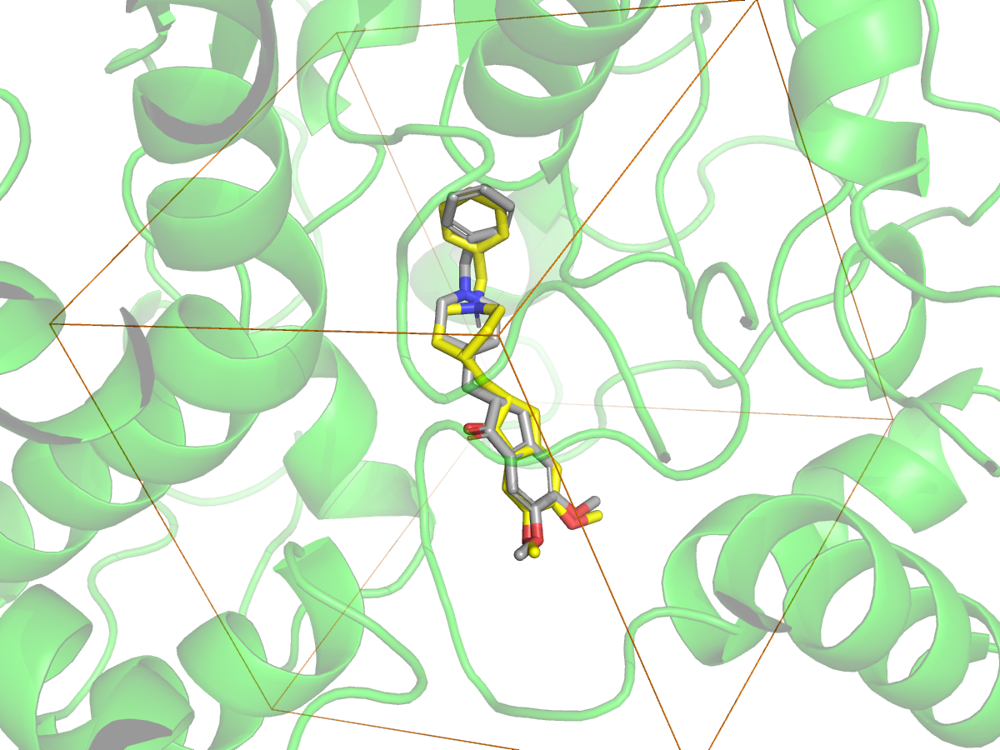

# AChE Docking Benchmark

Benchmarking AutoDock Vina for identifying acetylcholinesterase (AChE) inhibitors: can docking scores separate known AChE inhibitors from property-matched decoys (DUD-E)?

## Status

| Stage | Description | Status |
|---|---|---|
| 1 | Environment and repository setup | Done |
| 2 | Ligand and receptor preparation (donepezil, PDB 4EY7) | Done |
| 3 | Redocking validation | Done |
| 4 | Benchmark set (DUD-E actives and decoys) | Waiting: DUD-E server currently unreachable |
| 5 | Batch docking | Planned |
| 6 | Analysis (ROC AUC, enrichment factor, size bias) | Planned |
| 7 | Write-up | Planned |

## Results: docking protocol validation (redocking)

Donepezil was redocked into human AChE (PDB 4EY7, chain A) to check that the docking protocol reproduces the experimental binding pose.

| Ligand stereochemistry | Top-ranked score (kcal/mol) | RMSD of top pose vs crystal (Å) |
|---|---|---|
| R (as in the crystal) | -11.81 | **0.75** |
| S | -11.77 | 3.14 |

With the crystallographic R enantiomer, the top-ranked pose reproduced the native pose within 0.75 Å (success threshold: 2 Å). The S enantiomer scored almost identically, but its top pose was 3.14 Å away. Correct stereochemistry was essential, and a good score alone did not guarantee a correct pose.

<p>
  
  
</p>

Left: crystal pose (grey) and Vina top-ranked pose (yellow). Right: the 22 Å search box (orange) over the binding gorge.

## Methods so far

- **Receptor:** PDB 4EY7 (human AChE with donepezil, 2.35 Å). Chain A protein only (PyMOL); hydrogens added at pH 7.4 and converted to PDBQT (Open Babel).
- **Ligand:** donepezil built from SMILES in RDKit (protonated piperidine N, R configuration), 3D embedding (ETKDGv3, seed 42), MMFF optimisation, PDBQT via Meeko.
- **Docking box:** centred on the crystal donepezil centroid (-14.108, -43.833, 27.670), 22 × 22 × 22 Å (`prep/vina_config.txt`).
- **Docking:** AutoDock Vina, exhaustiveness 8, 9 poses, seed 42.
- **Pose accuracy:** symmetry-aware heavy-atom RMSD against the crystal pose (RDKit `CalcRMS`, no re-alignment).

## Repository structure

```
data/      raw input (PDB 4EY7)
prep/      prepared receptor and ligands, Vina config
scripts/   notebooks 01-03 and draw_box.py
results/   docking outputs and figures
notes.md   project log
```

## Reproduce

```bash
conda env create -f environment.yml
conda activate ache-docking
```

Then run the notebooks in `scripts/` in order.

## Tools

RDKit, Meeko, AutoDock Vina, Open Babel, PyMOL (open-source), pandas, scikit-learn, matplotlib, JupyterLab. Exact packages are listed in `environment.yml`.

## References

- Eberhardt J, Santos-Martins D, Tillack AF, Forli S. AutoDock Vina 1.2.0: new docking methods, expanded force field, and Python bindings. *J Chem Inf Model* 2021, 61, 3891-3898.
- Mysinger MM, Carchia M, Irwin JJ, Shoichet BK. Directory of Useful Decoys, Enhanced (DUD-E): better ligands and decoys for better benchmarking. *J Med Chem* 2012, 55, 6582-6594.
- Cheung J, et al. Structures of human acetylcholinesterase in complex with pharmacologically important ligands. *J Med Chem* 2012, 55, 10282-10286. (PDB 4EY7)

## Author

Shamsul Hoda (M.Sc. Biotechnology, IIT Roorkee)