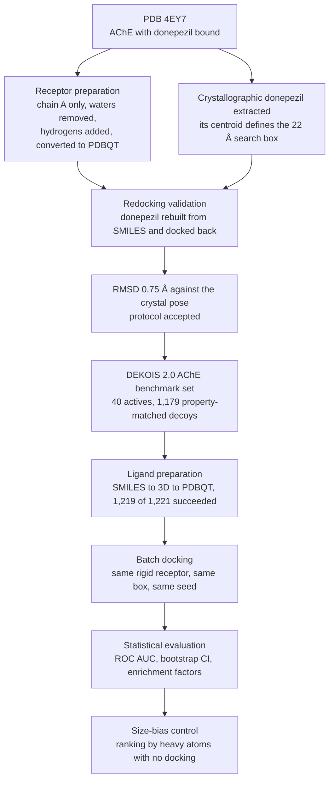
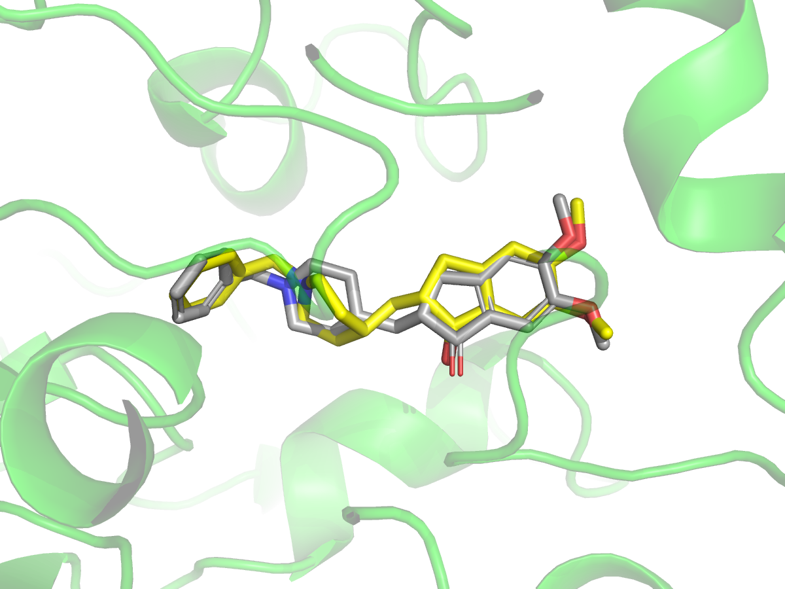
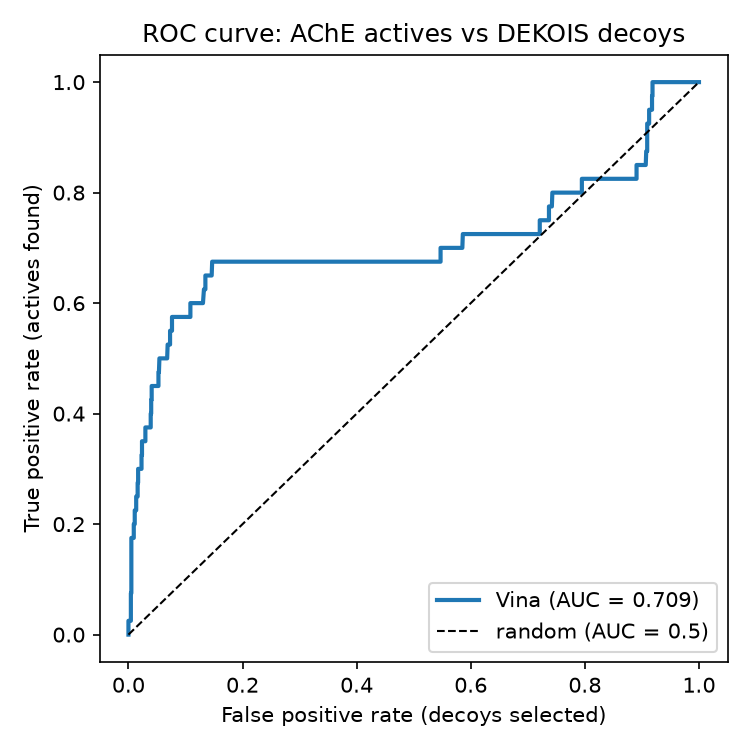
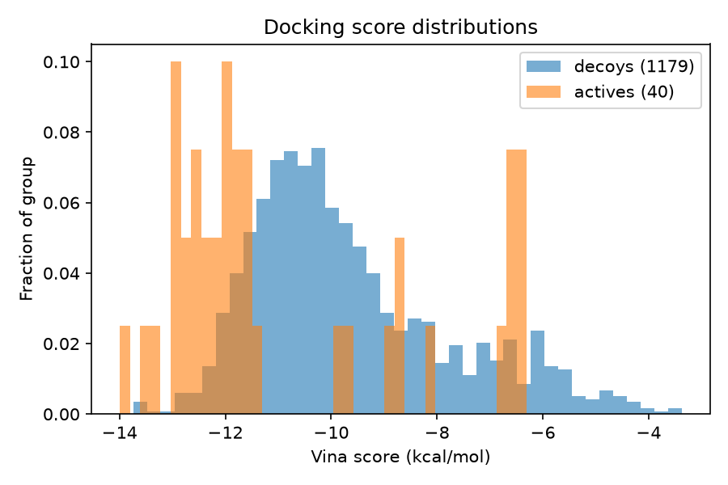
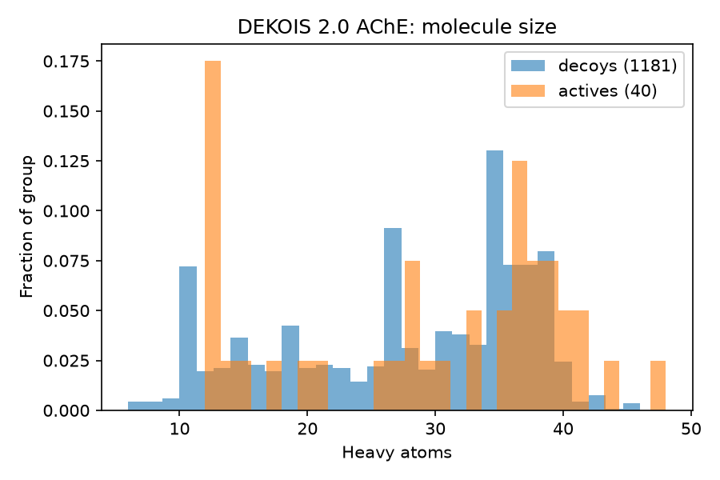
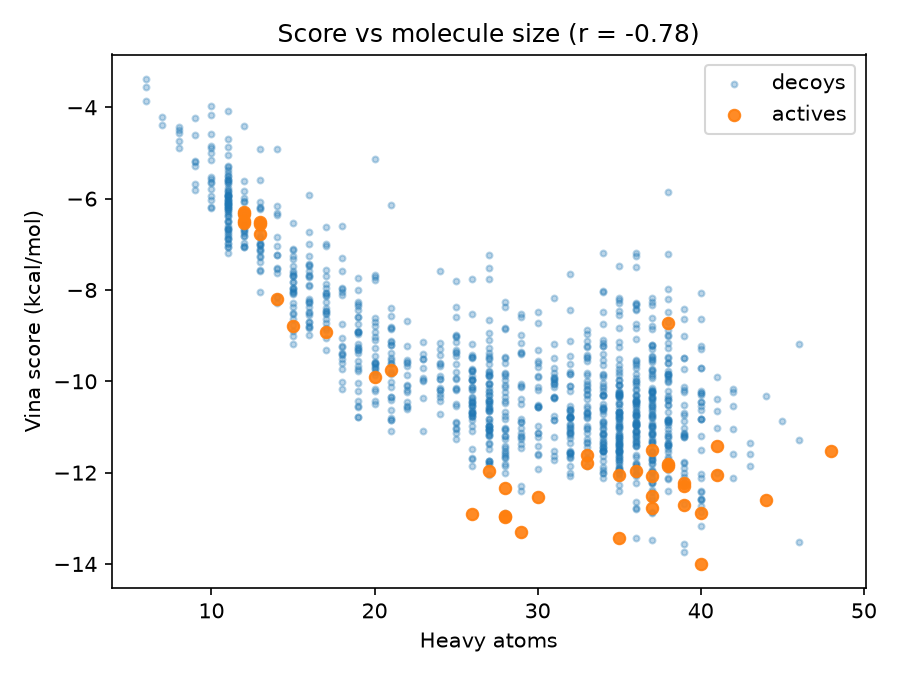
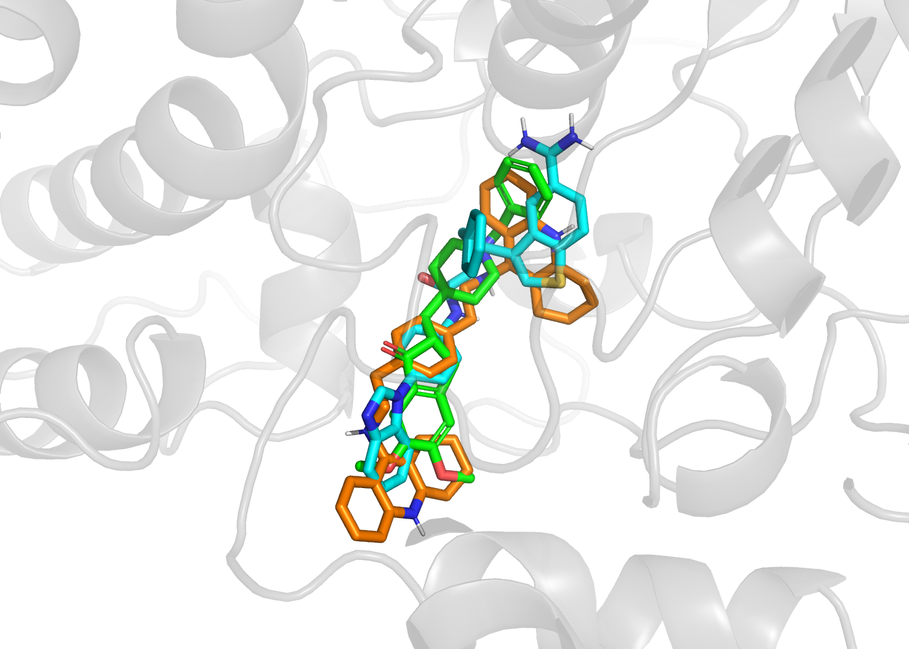
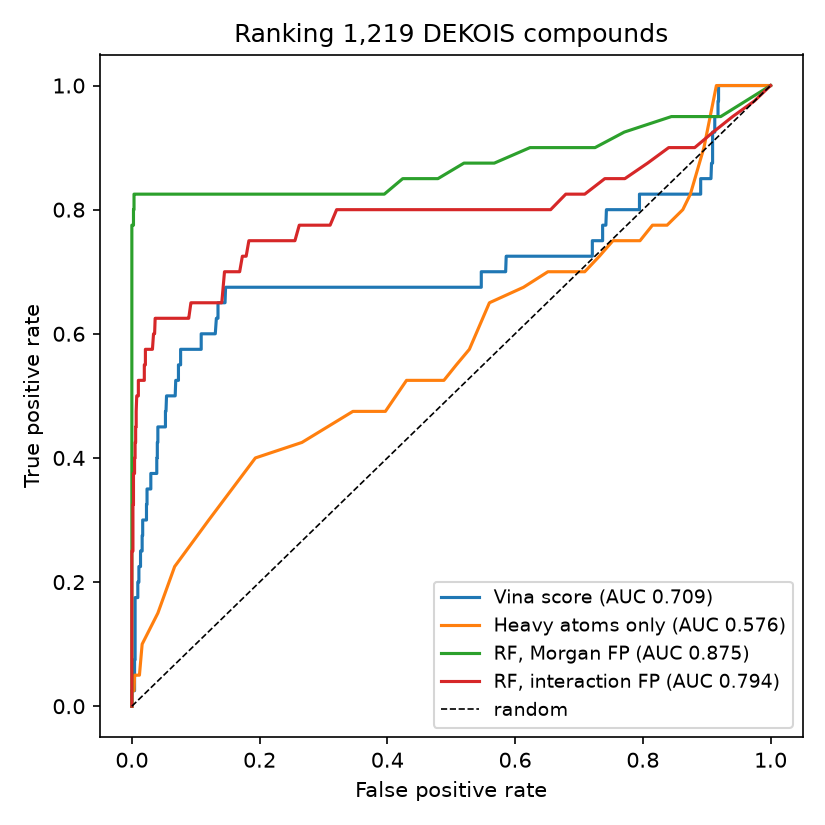
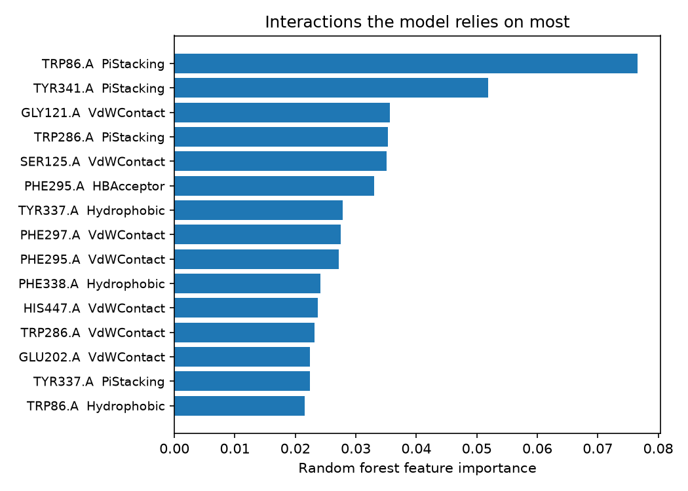

# Benchmarking AutoDock Vina on acetylcholinesterase

Protocol validation, a 1,219-compound virtual screen, and a control that tests whether the result is just molecular size.

Docking gives every molecule a score. It never refuses. Hand it a sugar, a dye, or a genuine drug, and it will place all three in the pocket and rate them. So the useful question is not whether a molecule fits, because almost anything fits something. The question is whether the ranking is informative: do the compounds that actually inhibit the enzyme end up near the top?

This repository is my attempt to answer that for one target. Everything is scripted and seeded, so you can rerun it. ## The workflow



---

## The test set

To ask the question properly you need molecules whose answer you already know. I used the DEKOIS 2.0 acetylcholinesterase set: 40 compounds with measured inhibition, and 1,179 decoys drawn from ZINC and matched to the actives on weight, logP, charge, hydrogen bonding and flexibility.

The decoys are the point. If they were small and polar, Vina would separate them trivially and I would learn nothing.

## Before screening anything, I checked the protocol worked

The control is redocking: take donepezil out of its own crystal structure, rebuild it from scratch, dock it back, and see whether the computer puts it where the X-ray experiment says it is.

My first attempt gave 3.14 Å RMSD. That fails, since the usual threshold is 2 Å.

The score, though, was −11.77 kcal/mol, which looks excellent. If I had only looked at the score, I would have concluded the setup was fine and moved on to screening a thousand compounds with a broken protocol.

The cause was stereochemistry. Donepezil has one chiral centre, and the crystal ligand is the R form. My SMILES string had not specified which, so RDKit picked one when it built the 3D structure, and it picked S. Vina can translate, rotate and twist rotatable bonds, but it cannot break a bond to invert a chiral centre, so it was being asked to fit a left hand into a right glove.

Specifying the R enantiomer explicitly and rebuilding gave **0.75 Å**, with a score of −11.81.

<p align="center">
  
</p>
<p align="center"><em>Crystallographic donepezil in grey, Vina's top-ranked pose in yellow, after the stereochemistry was fixed.</em></p>

The two scores differ by 0.04 kcal/mol. The two poses differ by 2.4 Å. That gap between scoring well and being correct is the most useful thing I took from this project, and it is why I would not trust a docking result that has not been validated this way first.

## Screening the library

With the protocol validated, I docked all 1,219 compounds into the same rigid receptor, with the same box and the same settings. One ligand at a time, each independent of the others, roughly like running 1,219 separate assay wells. It took 4.9 hours on twelve CPU threads.

Then I sorted everything by score and looked at what came out on top.

**Eight of the top twenty were actives.** Picking twenty compounds at random from this library would give 0.7 on average, usually zero. So the ranking carries real information.

<p align="center">
  
  
</p>
<p align="center"><em>Left: ROC curve, AUC 0.709. Right: the two score distributions, showing how much they overlap.</em></p>

The AUC came out at **0.709**, meaning a randomly chosen active beats a randomly chosen decoy about 71% of the time. With only 40 actives that number is not precise, so I bootstrapped it: 2,000 resamples gave a 95% interval of **0.591 to 0.818**. The whole interval sits above 0.5, so the effect is real, but it is wide, and quoting 0.709 on its own would pretend to a precision I do not have.

For screening, the more relevant number is enrichment at the top, because nobody tests the bottom of a ranking. In the top 1%, twelve compounds, six were actives: **15.2 times better than chance**. At 5% it drops to 7.5×, at 10% to 5.7×. That falling pattern is what you want, because it means the very top of the list is the part to trust.

## The shape of the curve was more informative than the number

The ROC curve climbs steeply for the first few molecules, then goes **flat** for a long stretch, then rises again near the end.

Flat means stepping sideways: hundreds of decoys selected, and not a single new active found. That is not what a smoothly mediocre method looks like. It means the actives sit in two separate clumps, one near the top of the ranking and one near the bottom, with nothing in between.

The size distribution explains it.

<p align="center">
  
  
</p>
<p align="center"><em>Left: the library has two size populations. Right: score against size, with actives in orange.</em></p>

The AChE gorge is about 20 Å deep with a binding site at each end, so medicinal chemists have made inhibitors long enough to reach both. Those molecules are large, and here they score −12 to −14. But roughly seven of the forty actives are small, rigid, tacrine-like compounds that occupy only one end. They are genuine inhibitors, some of them potent, and Vina puts them at the bottom of the list at −6 to −7.

That is not a flaw in my setup. Vina's scoring function sums atom-to-atom contacts, so a molecule with twelve heavy atoms cannot compete with one that has forty, however efficiently it binds. A screen built on this ranking would find the dual-site binders and miss the entire tacrine class.

## Then I tried to break the result

Since score correlates with size at r = −0.78, the obvious objection is that Vina is not recognising anything. It is rewarding bigger molecules, and the actives happen to be slightly bigger.

That is testable. Rank the whole library by heavy-atom count, do no docking at all, and compute the AUC.

| Ranking method | AUC |
|---|---|
| **Docking score** | **0.709** |
| Heavy atom count, no docking | 0.576 |
| Molecular weight, no docking | 0.542 |
| Ligand efficiency (score divided by heavy atoms) | 0.572 |

Size alone gives 0.576, barely above random. So the enrichment is not a size artefact, and docking contributes something real. That is the result I would defend if someone pushed back on this project.

The ligand efficiency row was a surprise. It is a standard medicinal chemistry correction and I expected it to help. Instead it made things worse, and put **zero** actives in the top twelve. Dividing by atom count over-corrects: it promotes small molecules, and in this library most small molecules are decoys. Vina's function already carries a flexibility penalty and was fitted against real binding data, so stacking a cruder correction on top of it destroys the signal rather than refining it.

## Why Vina cannot do better here

I opened the top-ranked active and the top-ranked decoy in PyMOL expecting the decoy to look obviously wrong. It does not.

<p align="center">
  
</p>
<p align="center"><em>Top-ranked active in orange, top-ranked decoy in cyan, crystallographic donepezil in green.</em></p>

They have near-identical scores (−13.99 and −13.74) and near-identical sizes, and both run the full length of the gorge between Trp286 at the entrance and Trp86 at the bottom, exactly as donepezil does. The decoy is not jammed into a surface groove or folded into something implausible. It fills the site convincingly.

That is the ceiling on performance, and it is a property of this target rather than a flaw in the method. The gorge is a long aromatic tunnel with a tryptophan at each end, so almost any elongated aromatic cation can stack between them and collect contacts. The decoys were deliberately built to share those properties. What distinguishes a real inhibitor is finer: exact geometry against those tryptophans, the right hydrogen bond at the right distance. An empirical function with about six terms cannot resolve it.

One caveat worth stating plainly. That decoy has never been tested against AChE. DEKOIS decoys are assumed inactive, not measured. So its high score is either a genuine false positive or an untested inhibitor, and nothing in this repository can tell you which.

## What I would check next

- **A second scoring function.** Vinardo uses the same search with re-optimised terms, so comparing them on this identical setup would isolate the scoring contribution cleanly.
- **A second dataset.** I planned to use DUD-E, but the server was unreachable throughout this work. The scripts would run on it unchanged.
- **Receptor flexibility.** Everything here used one rigid structure solved with donepezil bound, which may quietly favour donepezil-like ligands.
- **Whether that top decoy binds.** An Ellman assay would settle it in an afternoon.

## All results

| Metric | Value |
|---|---|
| Redocking RMSD, R enantiomer | 0.75 Å (threshold 2 Å) |
| Redocking RMSD, S enantiomer | 3.14 Å |
| Compounds screened | 1,219 (40 actives, 1,179 decoys) |
| ROC AUC | 0.709 (95% CI 0.591 to 0.818, 2,000 bootstraps) |
| Enrichment factor, top 1% / 5% / 10% | 15.2× / 7.5× / 5.7× |
| Actives in the top 20 | 8 (0.7 expected by chance) |
| Size-only baseline AUC | 0.576 |
| Score against heavy atoms | r = −0.78 |
| Docking time | 4.9 hours, 12 CPU threads |

## Methods

**Receptor.** PDB 4EY7, human acetylcholinesterase with donepezil bound, X-ray at 2.35 Å. I kept chain A protein only, removed waters and heteroatoms, added hydrogens at pH 7.4 and converted to PDBQT with Open Babel. The receptor is rigid throughout.

**Search box.** Centred on the centroid of the crystallographic donepezil at (−14.108, −43.833, 27.670), 22 Å on each side, covering the gorge from the catalytic site to the peripheral site. Stored in `prep/vina_config.txt` and reused without modification for every ligand, so all scores are comparable.

**Ligands.** Built from SMILES with RDKit using ETKDGv3 and seed 42, optimised with MMFF, converted to PDBQT with Meeko. 1,219 of 1,221 compounds prepared successfully; two decoys failed 3D embedding and are logged in `prep/ligand_prep_log.csv`.

**Docking.** AutoDock Vina 1.2, exhaustiveness 8, nine modes, seed 42.

**Analysis.** ROC AUC with a 2,000-sample bootstrap confidence interval, enrichment factors at 1%, 5% and 10%, and size controls by ranking on heavy-atom count and on molecular weight with no docking involved.

## Limitations

- **The decoys are assumed inactive, not measured.** Some fraction of them probably do bind, which means the AUC and enrichment figures here are lower bounds on true performance.
- **Forty actives is a small sample**, hence the ±0.11 confidence interval on the AUC.
- **One rigid holo receptor.** The 4EY7 pocket is shaped around donepezil and may favour similar ligands.
- **Small actives are systematically missed**, as described above. This is the main failure mode.
- **No explicit water, no covalent binders**, and the scoring function is accurate only to a few kcal/mol, so these scores are for ranking, not for estimating affinity.
- The copy of DEKOIS I used contains 1,181 of the official 1,200 decoys.

## Running it yourself

```bash
conda env create -f environment.yml
conda activate ache-docking
bash scripts/get_dekois_ache.sh        # fetch the benchmark set
python scripts/prepare_ligands.py      # SMILES to 3D to PDBQT
python scripts/dock_ligands.py         # batch docking, resumable
```

Then run the notebooks in `scripts/` in order. Every random seed is fixed, so you should get the same numbers.

```
data/      input structures; the DEKOIS set is fetched by script, not committed
prep/      prepared receptor and ligands, Vina configuration
scripts/   notebooks 01-05, plus the preparation, docking and box-drawing scripts
results/   scores, rankings, metrics and figures
notes.md   dated log of what I did each day, including the things that went wrong
```

**Tools:** RDKit, Meeko, AutoDock Vina 1.2, Open Babel, PyMOL, pandas, scikit-learn, matplotlib. Exact versions in `environment.yml`.

---

## ML extension: does a learned model beat the score?

Vina's scoring function was fitted once, against a general set of protein-ligand complexes, and it knows nothing about acetylcholinesterase specifically. The obvious follow-up question is whether a model allowed to learn from this dataset does better, and in particular whether it recovers the small inhibitors the physics-based score buries.

I built two, deliberately different.

**Ligand-only features.** Morgan fingerprints, radius 2, 2,048 bits, from the DEKOIS SMILES. The model sees chemistry and nothing else.

**Interaction features.** For every compound I rebuilt Vina's top-ranked pose and ran ProLIF against the protonated receptor, producing 115 bits of the form `TRP86.A|PiStacking`. The model sees how the molecule sits in the gorge. Poses were rebuilt from the SMILES Meeko writes into the PDBQT, so bond orders and stereochemistry come from the original structure rather than being guessed from coordinates.

Both go into a random forest, 500 trees, balanced class weights, fixed seed. No hyperparameter search.

### The evaluation matters more than the model

With 40 actives against 1,179 decoys it is easy to produce a flattering number by accident. Two things guard against it.

**Scaffold splitting.** Compounds are grouped by Bemis-Murcko scaffold and split with `StratifiedGroupKFold`, so no scaffold appears in both training and test folds. A random split would place close analogues on both sides, and the model would be graded on recognising molecules it had already seen.

**A label-shuffled control, run ten times.** A single scramble gave AUC 0.636 with a bootstrap interval that excluded 0.5, which looks like a leak but is not. The bootstrap measures precision within one scramble, not variation between scrambles. Across ten scrambles the mean AUC was 0.490 for the Morgan model and 0.499 for the interaction model, spanning 0.39 to 0.58, and **no scrambled run came within 0.2 of the real result**. That is the correct null, and it is clean.

### Results

All four methods ranking the same 1,219 compounds, scored with the same functions as the Vina benchmark above.

| Ranking method | ROC AUC | 95% CI | EF 1% | EF 5% |
|---|---|---|---|---|
| Vina score | 0.709 | 0.591 to 0.818 | 15.2× (6/12) | 7.5× (15/61) |
| Heavy atom count, no docking | 0.576 | 0.470 to 0.680 | 5.1× (2/12) | 3.0× (6/61) |
| **Random forest, Morgan fingerprints** | **0.875** | 0.780 to 0.952 | **30.5× (12/12)** | 16.5× (33/61) |
| Random forest, interaction fingerprints | 0.794 | 0.687 to 0.888 | 25.4× (10/12) | 11.5× (23/61) |

<p align="center">
  
</p>
<p align="center"><em>All four methods on the same 1,219 compounds. The Morgan curve reaches a true positive rate of 0.825, exactly 33 of 40 actives, at almost zero false positives, then goes flat.</em></p>

Both models beat Vina and the intervals barely overlap, so the difference is not noise. The ligand-only model also beats the structure-based one, which is the first sign that the docked geometry is not what is carrying the result.

### The headline number is not the finding

An AUC of 0.875 with 12 of 12 in the top 1% is strong enough that I went looking for the reason rather than reporting it and stopping.

The flat section of the green ROC curve is the answer. The model finds 33 actives almost perfectly and then finds nothing for the next 60% of the library. Those remaining seven are the compounds that matter here.

I defined small actives structurally, not by score: the sorted active sizes jump from 21 heavy atoms straight to 26, so the cutoff is 21, giving twelve compounds. Median ranks out of 1,219:

| Method | 12 small actives | 28 larger actives |
|---|---|---|
| Vina score | 1094 | 46 |
| Heavy atom count | 1065 | 155 |
| Random forest, Morgan | 550 | 14 |
| Random forest, interaction FP | 908 | 18 |

Those twelve split cleanly in two.

**Five were rescued**, from Vina ranks of 673 to 970 up to Morgan ranks of 27 to 37. They are tacrine, its dichloro analogue, N-benzylpiperidine and two related aminoquinolines. Every one of them is a **substructure of the large actives** the model trained on: the tacrine core sits inside the bivalent tacrine dimers, and N-benzylpiperidine is the donepezil pharmacophore. Scaffold splitting keeps whole scaffolds apart, but a Morgan fingerprint encodes fragments, so recognition transfers across the split. Tacrine and its analogue share a scaffold group and were held out together, and the model still placed them at 27 and 29 without ever seeing that scaffold.

**Seven were not rescued at all.** They are edrophonium and its methyl and methoxy analogues, trimethylammonium phenols at 12 to 13 heavy atoms that bind the catalytic anionic site. Vina ranks them around 1,100. The Morgan model ranks them 500 to 1,126. Their scaffold reduces to bare benzene, they are held out as a block, and there is nothing resembling them left in the training data.

So the honest reading is this. **The ligand-based model rescues small actives that are fragments of larger actives it has seen, and fails completely on a chemically unrelated series. It is recognising known pharmacophore fragments, not learning what binds acetylcholinesterase.** Neither Vina nor either model finds the edrophonium-type inhibitors. The failure mode I identified in the docking benchmark is narrowed by machine learning, not solved by it.

### What the interaction model keys on

<p align="center">
  
</p>
<p align="center"><em>Fitted on all 1,219 compounds for interpretation only. Every performance number above comes from out-of-fold predictions.</em></p>

Pi-stacking with Trp86 dominates, at roughly 1.5 times the next feature. Then pi-stacking with Tyr341 and Trp286, van der Waals contacts at Gly121 and Ser125, a hydrogen bond acceptor at Phe295, and contacts with Phe297, Phe338, His447 and Glu202.

That is the catalytic anionic site, the peripheral anionic site, the oxyanion hole, the acyl pocket and the catalytic triad histidine, recovered from 1,219 docked poses and 40 labels with no prior knowledge supplied. It matches the dual-binding-site model AChE inhibitors were designed around. Impurity-based importances are biased when features correlate and credit is shared between correlated bits, so these are associations in this dataset rather than evidence about what drives affinity.

### Limitations of this extension

- **Provenance, not just chemistry.** The 40 actives come from BindingDB, the decoys from ZINC. DEKOIS matched them on weight, logP, charge, hydrogen bonding and flexibility, but not on origin. Published inhibitors share synthetic motifs that catalogue compounds do not, and a Morgan fingerprint sees exactly those. Part of the 0.875 may be the model recognising literature compounds rather than binders. Scaffold splitting does not protect against this, because the artefact runs through the whole active set.
- **Forty actives.** Every interval here is wide for that reason, and the fold holding the seven edrophonium analogues carries 13 actives while others carry 6 or 7, because whole scaffolds cannot be divided.
- **The interaction fingerprints inherit Vina's errors.** A wrong pose gives wrong features, and nothing here detects that.
- **One target.** None of this says whether the same comparison holds elsewhere.
- No deep learning is involved, and none is claimed.

### Reproducing it

```bash
pdb2pqr --ff=AMBER --with-ph=7.4 --titration-state-method=propka \
        --pdb-output=prep/receptor_A_H.pdb prep/receptor_A.pdb prep/receptor_A.pqr
```

Then run `scripts/06_ml_features.ipynb`, `07_ml_models.ipynb` and `08_ml_analysis.ipynb` in order. Seeds are fixed throughout. Shared functions live in `scripts/ml_utils.py`, and all outputs land in `results/ml/`.


## References

- Eberhardt J, Santos-Martins D, Tillack AF, Forli S. AutoDock Vina 1.2.0: new docking methods, expanded force field, and Python bindings. *J Chem Inf Model* 2021, 61, 3891-3898.
- Bauer MR, Ibrahim TM, Vogel SM, Boeckler FM. Evaluation and optimization of virtual screening workflows with DEKOIS 2.0. *J Chem Inf Model* 2013, 53, 1447-1462.
- Cheung J, et al. Structures of human acetylcholinesterase in complex with pharmacologically important ligands. *J Med Chem* 2012, 55, 10282-10286. (PDB 4EY7)
- Bouysset C, Fiorucci S. ProLIF: a library to encode molecular interactions as fingerprints. *J Cheminform* 2021, 13, 72. https://doi.org/10.1186/s13321-021-00548-6
- Dolinsky TJ, Nielsen JE, McCammon JA, Baker NA. PDB2PQR: an automated pipeline for the setup of Poisson-Boltzmann electrostatics calculations. *Nucleic Acids Res* 2004, 32, W665-W667. https://doi.org/10.1093/nar/gkh381
- Pedregosa F, et al. Scikit-learn: machine learning in Python. *J Mach Learn Res* 2011, 12, 2825-2838.

## Author

Shamsul Hoda, M.Sc. Biotechnology, IIT Roorkee.